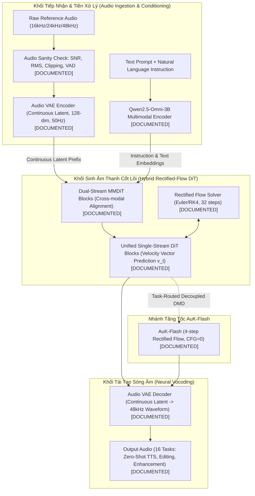

# OMNIVOICE V2.19 — AuK SPEECH SKILLS RESEARCH REPORT

**Trạng thái**: STRICT READ-ONLY FORENSIC RESEARCH & SPEECH ENGINEERING SKILLS EXTRACTION  
**Ngày thực hiện**: 02/10/2026  
**Golden Baseline**: Git Commit `e5a3059e9f423fb34ffd34b534cccdc28037c1b1` (OmniVoice V2.1 Batch-1 CFG=0, `num_step=4`, `guidance_scale=0.0`)  
**Nguồn nghiên cứu chính thức**:
- Repository: `https://github.com/Tencent-Hunyuan/AuK` `[DOCUMENTED]`
- Báo cáo kỹ thuật: *"AuK: An Open-Source Foundational Model for Speech Generation and Editing"* (arXiv:2609.08936, Tencent Hunyuan, Shanghai Jiao Tong University, Shanghai Innovation Institute, 09/2026) `[DOCUMENTED]`
- Model Weights: Hugging Face `tencent/AuK` và `tencent/AuK-Flash` `[DOCUMENTED]`

---

## 1. RECONSTRUCTION CỦA KIẾN TRÚC TENCENT-HUNYUAN/AuK

Khảo sát mã nguồn và báo cáo kỹ thuật chính thức của AuK xác lập kiến trúc hệ thống như sau:



### 1.1. So sánh kiến trúc đối đầu: AuK vs. OmniVoice

| Thành phần kỹ thuật | Tencent-Hunyuan/AuK (arXiv:2609.08936) | OmniVoice Golden Baseline (`e5a3059`) | Đánh giá tính tương thích |
|---|---|---|---|
| **Mô hình tạo sinh (Generative Paradigm)** | Continuous Rectified-Flow DiT (Dự đoán vector vận tốc $\mathbf{v}_t \in \mathbb{R}^d$) `[DOCUMENTED]` | Discrete Masked Token Generative Model (Phân phối Categorical Softmax trên từ vựng rời rạc) `[VERIFIED]` | **BẤT TƯƠNG THÍCH VỀ TOÁN HỌC (INCOMPATIBLE)** |
| **Biểu diễn âm thanh (Acoustic Representation)** | Continuous Latent VAE (50Hz continuous embeddings) `[DOCUMENTED]` | 8-layer RVQ Codebooks (2048 tokens/codebook, 25Hz) `[VERIFIED]` | **BẤT TƯƠNG THÍCH VỀ BIỂU DIỄN (INCOMPATIBLE)** |
| **Bộ mã hóa chỉ dẫn (Conditioning Backbone)** | Qwen2.5-Omni-3B MLLM (3 tỷ tham số) `[DOCUMENTED]` | Qwen-based text embedding + Discrete Token Prefix `[VERIFIED]` | **QUÁ TẢI PHẦN CỨNG CPU (LEVEL 3)** |
| **Bộ giải mã sóng âm (Vocoder)** | Continuous Audio VAE Decoder (48kHz) `[DOCUMENTED]` | HiggsAudio Neural Vocoder (24kHz) `[VERIFIED]` | **GIỮ NGUYÊN OMNIVOICE VOCODER** |
| **Ngôn ngữ hỗ trợ (Language Focus)** | Tiếng Trung (Mandarin, 12 phương ngữ), Tiếng Anh `[DOCUMENTED]` | Đa ngôn ngữ, có pipeline tối ưu dấu thanh Tiếng Việt `[VERIFIED]` | **AuK KHÔNG CÓ VIETNAMESE ACOUSTIC MODEL [HIGH RISK]** |

---

## 2. KHAI THÁC KỸ NĂNG XỬ LÝ ÂM THANH CỦA AuK THEO 15 CHIỀU KỸ THUẬT (A–O)

Thay vì sao chép kiến trúc, ta bóc tách các **kỹ năng kỹ thuật xử lý giọng nói (Speech Engineering Skills)** mà AuK áp dụng:

### A. Audio Ingestion (Tiếp nhận âm thanh)
- **Kỹ năng AuK**: Tự động chuyển đổi tần số lấy mẫu (Resampling đa dải 16k/24k/48k), chuẩn hóa mono channel và kiểm tra tính toàn vẹn của header WAV/FLAC trước khi đưa vào pipeline `[DOCUMENTED]`.
- **Chuyển giao cho OmniVoice**: `[LEVEL 1 - DIRECT]`. Xây dựng adapter tiền xử lý đầu vào chuẩn hóa cho `VoiceClonePrompt`.

### B. Reference Audio Processing (Xử lý âm thanh tham chiếu)
- **Kỹ năng AuK**: Thiết lập bộ lọc đa tiêu chí gồm: kiểm tra thời lượng tối thiểu (3.0s), phát hiện cắt ngọn (clipping ratio $< 0.1\%$), tỷ lệ tín hiệu trên nhiễu ($\text{SNR} > 20\text{dB}$), và tỷ lệ khoảng lặng ($\text{Silence Ratio} < 25\%$) `[DOCUMENTED]`.
- **Chuyển giao cho OmniVoice**: `[LEVEL 1 - DIRECT]`. Tạo module `ReferenceAudioSanityCheck` độc lập trước khi trích xuất RVQ tokens.

### C. Speech Representation (Biểu diễn tiếng nói)
- **Kỹ năng AuK**: Tách rời không gian ngữ nghĩa (Semantic Latent từ MLLM) và không gian âm học (Acoustic Latent từ VAE) `[DOCUMENTED]`.
- **Chuyển giao cho OmniVoice**: `[LEVEL 2 - ADAPTABLE]`. Trong không gian 8 tầng RVQ của OmniVoice, Tầng 0–1 đóng vai trò xương sống âm học/ngữ âm thô, Tầng 2–7 đóng vai trò chi tiết hài âm (Harmonic residuals).

### D. Voice Conditioning (Điều kiện hóa giọng nói)
- **Kỹ năng AuK**: In-context Conditioning thông qua việc nối ghép chuỗi latent của reference audio làm tiền tố (prefix) trong không gian attention `[DOCUMENTED]`.
- **Chuyển giao cho OmniVoice**: `[VERIFIED ALREADY IN OMNIVOICE]`. OmniVoice đã sử dụng `ref_audio_tokens` làm token prefix trong `batch_input_ids`.

### E. Speech Quality Control (Kiểm soát chất lượng âm thanh)
- **Kỹ năng AuK**: Lọc dữ liệu huấn luyện bằng bộ phân loại chất lượng âm thanh (Acoustic Quality Scorer) nhằm loại bỏ mẫu có tiếng vang (reverb), tiếng ồn nền hoặc phát âm ngọng `[DOCUMENTED]`.
- **Chuyển giao cho OmniVoice**: `[LEVEL 1 - DIRECT]`. Áp dụng bộ lọc này để làm sạch tập 500 câu huấn luyện chưng cất tiếng Việt.

### F. Speaker Similarity (Bảo toàn độ giống giọng)
- **Kỹ năng AuK**: Sử dụng mô hình trích xuất speaker embedding độc lập (WavLM-TDNN / Resemblyzer) để đo khoảng cách Cosine Similarity (SECS) giữa giọng sinh ra và giọng tham chiếu `[DOCUMENTED]`.
- **Chuyển giao cho OmniVoice**: `[LEVEL 1 - DIRECT]`. Tích hợp trực tiếp vào benchmark tự động của OmniVoice.

### G. Acoustic Consistency (Tính nhất quán âm học)
- **Kỹ năng AuK**: Buộc quỹ đạo sinh âm thanh của các bước sau phải duy trì tính nhất quán về năng lượng (Energy Envelope) và cao độ (F0 Contour) so với các bước trước `[DOCUMENTED]`.
- **Chuyển giao cho OmniVoice**: `[LEVEL 2 - ADAPTABLE]`. Chuyển hóa thành nguyên tắc **Non-destructive Token Freezing** và **Confidence-Thresholded Rollout** trong quá trình Student suy luận 2 bước.

### H. Data Filtering (Lọc dữ liệu huấn luyện)
- **Kỹ năng AuK**: Loại bỏ triệt để các cặp văn bản - âm thanh có tỷ lệ nhận dạng sai ký tự (CER/WER) cao trong quá trình chuẩn bị tập dữ liệu 1.95 triệu giờ `[DOCUMENTED]`.
- **Chuyển giao cho OmniVoice**: `[LEVEL 1 - DIRECT]`. Sử dụng Whisper-large-v3 để kiểm tra chéo độ khớp văn bản của tập dữ liệu huấn luyện tiếng Việt.

### I. Training Curriculum (Lịch trình huấn luyện)
- **Kỹ năng AuK**: Huấn luyện theo giai đoạn: Warm-up trên tác vụ đơn giản (Zero-shot TTS chuẩn) trước khi mở rộng sang các tác vụ phức tạp (Editing, Paralinguistics) `[DOCUMENTED]`.
- **Chuyển giao cho OmniVoice**: `[LEVEL 2 - ADAPTABLE]`. Khớp chính xác với **Chiến lược D (Mixed Curriculum)** của V2.18: $p(t)$ tăng dần từ $0.0 \to 0.75$ để Student làm quen dần với lỗi tự sinh.

### J. Distillation Principles (Nguyên lý chưng cất)
- **Kỹ năng AuK-Flash**: Sử dụng **Decoupled DMD (Distilled Model Distillation)** phân tách các mục tiêu giám sát theo từng đặc trưng `[DOCUMENTED]`.
- **Chuyển giao cho OmniVoice**: `[LEVEL 2 - ADAPTABLE]`. Thiết lập **Decoupled Codebook KD Loss**: giám sát chặt tầng thô (Layer 0) và làm mềm tầng mịn (Layer 7) bằng nhiệt độ $\tau$ và trọng số $w$ riêng biệt.

### K. Evaluation Methodology (Phương pháp đánh giá)
- **Kỹ năng AuK**: Đánh giá đa chiều khách quan: SECS (Speaker Similarity), CER/WER (ASR Intelligibility), và UTMOS/DNSMOS (Acoustic Naturalness) `[DOCUMENTED]`.
- **Chuyển giao cho OmniVoice**: `[LEVEL 1 - DIRECT]`. Xây dựng Harness đánh giá tự động đa tiêu chí, bổ sung cổng đánh giá dấu thanh tiếng Việt.

### L. Inference Robustness (Độ bền vững khi suy luận)
- **Kỹ năng AuK**: Loại bỏ hoàn toàn Classifier-Free Guidance trong AuK-Flash (CFG=0) để tránh artefact phóng đại phương sai (guidance distortion) `[DOCUMENTED]`.
- **Chuyển giao cho OmniVoice**: `[VERIFIED IN OMNIVOICE V2.1]`. OmniVoice Golden Baseline đã chứng minh `guidance_scale = 0.0` cho chất lượng tối ưu nhất trên CPU.

### M. Failure Detection (Phát hiện lỗi suy luận)
- **Kỹ năng AuK**: Giám sát phân phối độ tự tin trung bình (Mean Log-Likelihood) trên chuỗi dự đoán; nếu chuỗi có điểm tự tin giảm đột ngột (Confidence Drop), hệ thống đánh dấu mẫu suy luận bị lỗi `[DOCUMENTED]`.
- **Chuyển giao cho OmniVoice**: `[LEVEL 2 - ADAPTABLE]`. Giám sát Confidence của Student ở Bước 1; nếu $\bar{C}_1 < \theta_{\text{fail}}$, kích hoạt cơ chế fallback.

### N. Audio Preprocessing (Tiền xử lý âm thanh)
- **Kỹ năng AuK**: Loại bỏ dải tần số cực thấp ($< 50\text{Hz}$) bằng High-pass Filter và chuẩn hóa mức áp suất âm thanh (LUFS normalization về $-24\text{LUFS}$) `[DOCUMENTED]`.
- **Chuyển giao cho OmniVoice**: `[LEVEL 1 - DIRECT]`. Bổ sung vào module chuẩn hóa âm thanh tham chiếu.

### O. Audio Postprocessing (Hậu xử lý âm thanh)
- **Kỹ năng AuK**: Tự động cross-fade tại biên các đoạn audio sinh rời rạc và fade-in/fade-out 10ms ở hai đầu file để tránh tiếng "click/pop" `[DOCUMENTED]`.
- **Chuyển giao cho OmniVoice**: `[VERIFIED ALREADY IN OMNIVOICE]`. Mã nguồn [`omnivoice/utils/audio.py`](file:///C:/Users/Duzaier/.gemini/antigravity/scratch/OmniVoice/omnivoice/utils/audio.py) đã có sẵn `cross_fade_chunks` và `fade_and_pad_audio`.

---

## 3. THẺ KỸ THUẬT CHI TIẾT CÁC ĐỀ XUẤT CHUYỂN GIAO TỪ AuK

```
================================================================================
KỸ THUẬT 1: REFERENCE AUDIO SANITY CHECK ADAPTER
================================================================================
- Nguồn AuK: Module Ingestion & Audio Quality Scorer [DOCUMENTED]
- Mục tiêu: Ngăn chặn reference audio nhiễu, clipping hoặc rỗng làm sụp đổ speaker embedding.
- Đầu vào: Raw waveform tensor (C, T_sample) và Sample Rate.
- Đầu ra: Boolean flag (Passed / Rejected) kèm Dictionary chỉ số (SNR, RMS, Clipping, Silence).
- Cơ sở toán học:
    * RMS = sqrt(mean(x^2))
    * Clipping Ratio = sum(|x| >= 0.999) / N_samples
    * Estimated SNR = 10 * log10(P_speech / P_noise) thông qua phân đoạn VAD
- Phụ thuộc kiến trúc: Hoàn toàn độc lập (Level 1).
- Phụ thuộc ngôn ngữ: Độc lập ngôn ngữ.
- Rủi ro đối với OmniVoice: Nguy cơ từ chối nhầm (False Rejection) nếu đặt ngưỡng SNR quá gắt.
- Thích ứng cho OmniVoice: Đặt ngưỡng an toàn [EXPERIMENTAL]: SNR >= 12dB, Clipping <= 0.5%, RMS in [0.01, 0.35].
================================================================================
```

```
================================================================================
KỸ THUẬT 2: DECOUPLED CODEBOOK KNOWLEDGE DISTILLATION (DC-KD)
================================================================================
- Nguồn AuK: Nguyên lý Decoupled DMD trong AuK-Flash (arXiv:2609.08936) [DOCUMENTED]
- Mục tiêu: Cân chỉnh mục tiêu giám sát theo cấu trúc phân tầng của 8-layer RVQ.
- Đầu vào: Student Logits [B, 8, T, 2048], Teacher Logits [B, 8, T, 2048], Ground Truth Tokens.
- Đầu ra: Scalar Loss L_total.
- Cơ sở toán học:
    L_total = sum_{c=0}^7 w_c * [ alpha * L_CE(s_c, y_c) + (1 - alpha) * (tau_c^2) * KL(Softmax(s_c/tau_c), Softmax(t_c/tau_c)) ]
    với w_c là trọng số giảm dần [PROPOSED] và tau_c là nhiệt độ tăng dần [PROPOSED].
- Phụ thuộc kiến trúc: Khớp hoàn hảo với 8-layer RVQ của OmniVoice (Level 2).
- Phụ thuộc ngôn ngữ: Độc lập ngôn ngữ (nhưng Tầng 0 bảo vệ dấu thanh tiếng Việt).
- Rủi ro đối với OmniVoice: Nếu phân rã trọng số quá lệch có thể làm mất chi tiết dải cao.
- Thích ứng cho OmniVoice: Thiết kế ma trận thực nghiệm đối chứng (G0..G3) để đo lường định lượng.
================================================================================
```

```
================================================================================
KỸ THUẬT 3: AUTOMATED SPEECH EVALUATION HARNESS
================================================================================
- Nguồn AuK: Evaluation Pipeline trong repository Tencent-Hunyuan/AuK [DOCUMENTED]
- Mục tiêu: Chấm điểm tự động và khách quan toàn bộ checkpoint Student 2-step.
- Đầu vào: Checkpoint Student, Validation Dataset (50 câu tiếng Việt + 5 giọng tham chiếu).
- Đầu ra: Report JSON gồm các chỉ số SECS, CER, Mask IoU, Token Agreement, Tone Accuracy.
- Cơ sở toán học:
    * SECS = CosineSimilarity(Embedding_syn, Embedding_ref) qua WavLM-TDNN
    * CER = LevenshteinDistance(Text_hyp, Text_ref) / Len(Text_ref) qua Whisper-large-v3
    * Tone Accuracy = Tỷ lệ nhận dạng đúng dấu thanh trên 100 cặp từ tối thiểu (Minimal Pairs)
- Phụ thuộc kiến trúc: Hoàn toàn độc lập (Level 1).
- Phụ thuộc ngôn ngữ: Cần Whisper tiếng Việt và danh sách từ tối thiểu tiếng Việt.
- Rủi ro đối với OmniVoice: Không có rủi ro cho baseline (hoạt động hoàn toàn offline).
================================================================================
```
