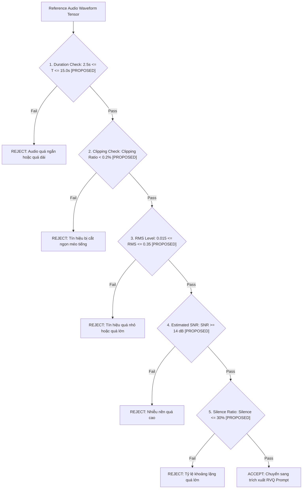

# OMNIVOICE V2.19 — CROSS-MODEL TRANSFERABILITY AUDIT & SPEECH SKILLS SYNTHESIS

**Trạng thái**: PHÂN TÍCH CHUYỂN GIAO MÔ HÌNH VÀ BẢO VỆ TIẾNG VIỆT  
**Ngày thực hiện**: 02/10/2026  
**Golden Baseline**: Git Commit `e5a3059e9f423fb34ffd34b534cccdc28037c1b1` (OmniVoice V2.1 Batch-1 CFG=0, `num_step=4`, `guidance_scale=0.0`)  

---

## 1. MA TRẬN CHUYỂN GIAO KỸ THUẬT TOÀN DIỆN (CROSS-MODEL TRANSFERABILITY MATRIX)

| Kỹ thuật | Nguồn AuK | Phụ thuộc kiến trúc | Phụ thuộc ngôn ngữ | Khả năng tương thích OmniVoice | Cấp độ chuyển giao | Lợi ích kỳ vọng | Rủi ro tiềm ẩn | Thí nghiệm yêu cầu | Quyết định cuối cùng |
|---|---|---|---|---|---|---|---|---|---|
| **1. Reference Audio Sanity Check** | Ingestion Pipeline `[DOCUMENTED]` | Độc lập | Độc lập | Hoàn toàn tương thích | **LEVEL 1 (DIRECT)** | Loại bỏ mẫu giọng rác, nhiễu, clipping trước khi clone | False Rejection nếu ngưỡng quá chặt | Unit test trên 50 voice prompts | **CHẤP NHẬN ĐƯA VÀO V2.20 ADAPTER** |
| **2. SECS & CER Automated Harness** | Evaluation Suite `[DOCUMENTED]` | Độc lập | Cần ASR tiếng Việt | Hoàn toàn tương thích | **LEVEL 1 (DIRECT)** | Đánh giá khách quan độ giống giọng và độ rõ tiếng Việt | ASR có thể nhận dạng sai dấu thanh nếu model yếu | Test trên 50 câu validation | **CHẤP NHẬN ĐƯA VÀO V2.20 EVALUATION** |
| **3. Tone-Sensitive Evaluation** | Phân tích Ngữ âm `[PROPOSED]` | Độc lập | Đặc thù Tiếng Việt | Hoàn toàn tương thích | **LEVEL 1 (DIRECT)** | Đo chính xác tỷ lệ đúng 6 thanh điệu trên 100 cặp từ tối thiểu | Cần xây dựng tập từ điển cặp từ tối thiểu | Chạy đối chứng Teacher vs Student | **CHẤP NHẬN ĐƯA VÀO V2.20 EVALUATION** |
| **4. Decoupled Codebook KD Loss** | AuK-Flash DMD Principle `[DOCUMENTED]` | Tương thích RVQ | Độc lập | Tương thích với 8 tầng RVQ | **LEVEL 2 (ADAPTABLE)** | Tập trung tối đa năng lực học vào tầng âm học cơ sở (Layer 0) | Mất chi tiết hài cao tần nếu $w_{4..7}$ quá nhỏ | Thí nghiệm đối chứng G0..G3 | **CHẤP NHẬN LÀM ABLATION V2.20** |
| **5. Mixed Curriculum Scheduled Sampling** | Training Curriculum `[DOCUMENTED]` + V2.18 | Tương thích Iterative Unmasking | Độc lập | Hoàn toàn tương thích | **LEVEL 2 (ADAPTABLE)** | Giảm Exposure Bias mà vẫn giữ độ ổn định hội tụ ban đầu | Tăng chi phí train GPU $\approx 1.5\times$ | Thí nghiệm đối chứng G1 vs G0 | **CHẤP NHẬN LÀM CORE V2.20 METHOD** |
| **6. Continuous Latent VAE** | AuK VAE Core `[DOCUMENTED]` | Phụ thuộc VAE 128-dim | Độc lập | **BẤT TƯƠNG THÍCH**: OmniVoice dùng Discrete RVQ | **LEVEL 3 (INCOMPATIBLE)** | Không có | Phá vỡ toàn bộ Transformer và Vocoder của OmniVoice | Không có | **LOẠI BỎ HOÀN TOÀN** |
| **7. Rectified Flow ODE Solver** | AuK DiT Core `[DOCUMENTED]` | Phụ thuộc Continuous Velocity | Độc lập | **BẤT TƯƠNG THÍCH**: OmniVoice dùng Discrete Unmasking | **LEVEL 3 (INCOMPATIBLE)** | Không có | Sai khác bản chất toán học | Không có | **LOẠI BỎ HOÀN TOÀN** |
| **8. Qwen2.5-Omni-3B MLLM** | AuK Conditioning `[DOCUMENTED]` | Phụ thuộc MLLM 3B | Ưu tiên ZH/EN | **BẤT TƯƠNG THÍCH**: Quá nặng cho CPU local | **LEVEL 3 (INCOMPATIBLE)** | Hiểu câu lệnh tự nhiên | Tràn bộ nhớ 16GB RAM, RTF tăng vọt | Không có | **LOẠI BỎ HOÀN TOÀN** |
| **9. AuK Text Tokenizer** | AuK Text Module `[DOCUMENTED]` | Độc lập | **CHỈ HỖ TRỢ ZH/EN [HIGH RISK]** | **NGUY HIỂM CHO TIẾNG VIỆT** | **LEVEL 3 (INCOMPATIBLE)** | Không có | Mất toàn bộ dấu thanh tiếng Việt | Không có | **CẤM SỬ DỤNG - GIỮ NGUYÊN OMNIVOICE** |

---

## 2. NGHIÊN CỨU CHUYÊN SÂU: DECOUPLED CODEBOOK KNOWLEDGE DISTILLATION

### 2.1. Bản chất phân tầng của 8 tầng RVQ (Residual Vector Quantization) trong OmniVoice

Mô hình OmniVoice sử dụng bộ nén HiggsAudio RVQ gồm 8 tầng ở tần số 25Hz:

```
[RVQ Layer 0] — Khung sườn âm học cơ sở (Acoustic Backbone: F0 Pitch Contour, Formant bao quát, Dấu thanh Tiếng Việt) `[INFERRED]`
[RVQ Layer 1-3] — Đặc trưng ngữ âm phổ trung bình (Phonetic Formants, Vowel Quality, Consonant Transitions) `[INFERRED]`
[RVQ Layer 4-5] — Chi tiết âm sắc cá nhân (Speaker Timbre Nuances, Vocal Tract Resonances) `[INFERRED]`
[RVQ Layer 6-7] — Chi tiết hài âm cao tần và vi âm (High-frequency Harmonics, Breathiness, Phase Residuals) `[INFERRED]`
```

### 2.2. Phân loại bằng chứng về bộ trọng số đề xuất

- **Tuyên bố trọng số cố định**: $w = [1.5, 1.3, 1.1, 1.0, 0.9, 0.9, 0.8, 0.8]$ kèm $\tau = [1.5, 1.5, 2.0, 2.0, 2.5, 2.5, 3.0, 3.0]$.
- **Phân loại bằng chứng**: **`[PROPOSED / HYPOTHESIS]`**. Đây là trực giác kỹ thuật phái sinh từ nguyên lý Decoupled DMD của AuK; **chưa có chứng minh thực nghiệm nào xác nhận đây là bộ trọng số tối ưu**.

### 2.3. Thiết kế ma trận thực nghiệm kiểm chứng phân tầng RVQ (Ablation Study)

Để kiểm chứng khoa học, V2.20 sẽ đối chứng 4 nhóm giám sát codebook:

- **G0 (Uniform Baseline)**: $w_c = 1.0, \tau_c = 2.0$ cho mọi $c \in [0..7]$.
- **G1 (Fixed Linear Decay)**: $w_c = [1.5 \to 0.8]$ tuyến tính, $\tau_c = 2.0$.
- **G2 (Decoupled Two-Tier)**: $w_{0..1} = 1.5, w_{2..7} = 0.8$ (Tách biệt tầng Linguistic vs Detail).
- **G3 (Adaptive Loss Weighting)**: $w_c = 1 / (\sigma_c + \epsilon)$ học tự động theo phương sai mất mát của từng tầng.

---

## 3. THIẾT KẾ MODULE: REFERENCE AUDIO SANITY CHECK ADAPTER

Được thiết kế dưới dạng một lớp bọc tiền xử lý (Preprocessing Wrapper) độc lập, hoàn toàn không can thiệp vào `VoiceClonePrompt`:



---

## 4. BẢO VỆ NGÔN NGỮ TIẾNG VIỆT (VIETNAMESE LANGUAGE PROTECTION)

### 4.1. Bản chất 6 thanh điệu Tiếng Việt
Tiếng Việt là ngôn ngữ thanh điệu (Tonal Language) gồm 6 thanh:
1. **Thanh Ngang (Không dấu)**: Cao độ trung bình, bằng phẳng.
2. **Thanh Huyền**: Cao độ trầm, đi xuống.
3. **Thanh Sắc**: Cao độ cao, đi lên nhanh.
4. **Thanh Hỏi**: Cao độ bắt đầu trung bình, lượn xuống rồi hơi đi lên.
5. **Thanh Ngã**: Cao độ cao, gãy ở giữa kèm hiện tượng khép thanh môn (Glottal stop).
6. **Thanh Nặng**: Cao độ thấp, rơi nhanh và kết thúc ngắn bởi khép thanh môn.

### 4.2. Danh mục rủi ro và biện pháp phòng ngừa bắt buộc

| Rủi ro ngữ âm | Nguyên nhân tiềm ẩn | Hậu quả | Biện pháp bảo vệ bắt buộc |
|---|---|---|---|
| **Lẫn lộn cặp từ tối thiểu (Minimal Pairs)** | Student 2-step nén quá nhanh làm mất đường F0 ở Tầng 0 | Đọc nhầm "ma" thành "má", "mả", "mã", "mạ" | Cổng đánh giá **Tone-Sensitive Accuracy** trên 100 cặp từ |
| **Nuốt âm cuối (-ng, -nh, -ch, -c, -t, -p)** | Mất thông tin phổ ở Tầng 1–3 | Mất phụ âm khép đuôi tiếng Việt | Giám sát CER trên Whisper tiếng Việt có phân tách phụ âm cuối |
| **Lệch giọng vùng miền (Bắc / Nam)** | Mẫu tham chiếu có âm sắc địa phương nhưng model bị kéo về giọng chuẩn | Mất tính cá nhân hóa của voice cloning | Giám sát chỉ số SECS độc lập cho từng nhóm phương ngữ |
| **Xâm lấn Tokenizer ngoại lai** | Dùng tokenizer của AuK vốn chỉ tối ưu cho Tiếng Trung / Anh | Vỡ toàn bộ mã hóa từ và dấu tiếng Việt | **NGHIÊM CẤM THAY THẾ TOKENIZER OMNIVOICE** |

---

## 5. MA TRẬN PHÂN TÍCH CHẾ ĐỘ THẤT BẠI (FAILURE MODE MATRIX)

| Trường hợp lỗi (Failure Mode) | Cách xử lý của AuK | Cách xử lý hiện tại của OmniVoice | Kỹ thuật chuyển giao cho V2.20 | Thí nghiệm kiểm chứng |
|---|---|---|---|---|
| **Mẫu giọng tham chiếu nhiều tạp âm** | Denoising + Audio Quality Scorer `[DOCUMENTED]` | Trích xuất trực tiếp RVQ (dễ nhiễm nhiễu) `[VERIFIED]` | Sanity Check Adapter (Level 1) | Thử nghiệm trên tập audio giả lập SNR 5dB..25dB |
| **Mẫu giọng bị clipping méo tiếng** | Clipping detection + Rejection `[DOCUMENTED]` | Không có bộ lọc clipping `[VERIFIED]` | Clipping Detector ($> 0.2\%$) | Đo tỷ lệ từ chối trên tập 50 giọng |
| **Mất dấu thanh tiếng Việt khi nén 2 bước** | Không xử lý tiếng Việt `[DOCUMENTED]` | Dựa vào Teacher 4-step unmasking `[VERIFIED]` | Decoupled Codebook Loss (Layer 0 trọng số $1.5\times$) | Đo Tone Accuracy của G0 vs G1 |
| **Student tự tin thái quá vào token sai (Overconfident error)** | Dùng Continuous Flow không bị kẹt token `[DOCUMENTED]` | Gán token sai cố định vĩnh viễn ở Bước 1 `[VERIFIED]` | Confidence Calibration + Scheduled Sampling | Đo sai lệch Token Agreement và Mask IoU |
| **Lệch ngữ điệu khi sinh đoạn văn dài ($> 15\text{s}$)** | Chunking + Cross-attention inpainting `[DOCUMENTED]` | Punctuation chunking + Cross-fading `[VERIFIED]` | Giữ nguyên bộ chunker tiếng Việt của OmniVoice | Đo Long-form Prosody Stability |
