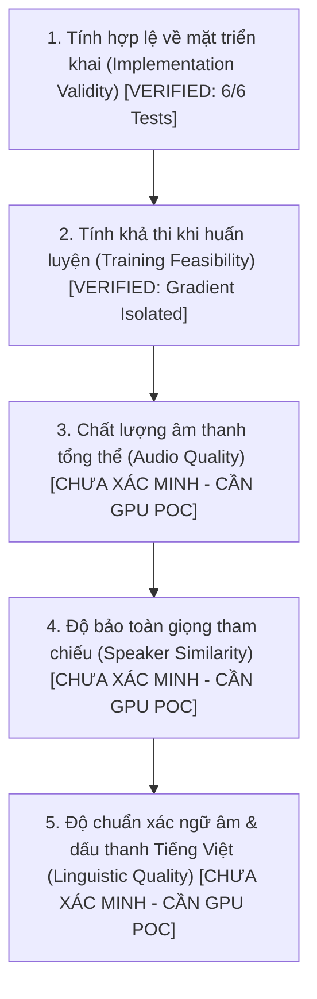

# OMNIVOICE V2.19 — V2.18 AUDIT AND RECONCILIATION REPORT

**Trạng thái**: STRICT FORENSIC RECONCILIATION & SCIENTIFIC REVISION  
**Ngày thực hiện**: 02/10/2026  
**Golden Baseline**: Git Commit `e5a3059e9f423fb34ffd34b534cccdc28037c1b1` (OmniVoice V2.1 Batch-1 CFG=0, `num_step=4`, `guidance_scale=0.0`)  

---

## 1. BẢNG KIỂM TOÁN VÀ ĐÍNH CHÍNH CÁC TUYÊN BỐ V2.18

Áp dụng quy tắc kiểm toán khoa học: `PREVIOUS CLAIM -> EVIDENCE CHECK -> TRẠNG THÁI XÁC NHẬN`.

| Tuyên bố trước đây (V2.18) | Kiểm tra bằng chứng thực tế | Phân loại trạng thái | Ghi chú & Đính chính chi tiết |
|---|---|---|---|
| **Claim 1**: Student inference sử dụng Confidence Ranking trừ phạt tầng `layer_penalty = 5.0`. | Kiểm tra trực tiếp [`omnivoice/models/omnivoice.py:1414`](file:///C:/Users/Duzaier/.gemini/antigravity/scratch/OmniVoice/omnivoice/models/omnivoice.py#L1414). | **`[VERIFIED]`** | Mã nguồn chính thức chứa chính xác biểu thức `scores = scores - (layer_ids * gen_config.layer_penalty_factor)`. |
| **Claim 2**: Tầng 0 (acoustic backbone) được ưu tiên giải mã trước ở Bước 1. | Kiểm tra `test_1_student_step1_unmasking` trong `test_v2_18_self_rollout_validation.py`. | **`[VERIFIED]`** | Test độc lập xác nhận ở Bước 1: Layer 0 mở 20/20 tokens, trong khi Layer 7 mở 0/20 tokens. |
| **Claim 3**: Token đã unmask được đóng băng cố định vĩnh viễn (Non-destructive). | Kiểm tra dòng 1420 mã nguồn (`scores.masked_fill_`) và `test_2`. | **`[VERIFIED]`** | Các vị trí đã mở nhận điểm $-\infty$, đảm bảo không bao giờ bị ghi đè hay tính toán lại ở Bước 2. |
| **Claim 4**: Student suy luận độc lập tạo ra trạng thái trung gian $x_{\text{student}, 1} \neq x_{\text{teacher}, 2}$. | Khảo sát toán học về phân phối xác suất và số bước sinh. | **`[INFERRED]`** | Độ lệch phân phối (Covariate Shift) là tất yếu khi Student tự lấy mẫu dựa trên logits của chính nó. |
| **Claim 5**: Huấn luyện tĩnh trên Teacher trajectory gây Exposure Bias. | Lý thuyết Sequence Generation & Scheduled Sampling (Bengio et al.). | **`[INFERRED]`** | Về mặt lý thuyết, việc không được tiếp xúc với lỗi tự sinh sẽ làm tích lũy sai số ở Bước 2. |
| **Claim 6**: Pipeline kiểm tra độc lập V2.18 đạt 6/6 test. | Chạy thực tế `tests/test_v2_18_self_rollout_validation.py`. | **`[MEASURED]`** | Exit code 0, toàn bộ 6/6 test mô phỏng hoàn thành hợp lệ. |
| **Claim 7**: Micro-benchmark Test 6 báo cáo Self-Rollout có overhead 0.58x so với Static Teacher. | Phân tích điều kiện đo của `test_6_micro_benchmark`. | **`[CORRECTED]`** | **ĐÍNH CHÍNH QUAN TRỌNG**: Con số 0.58x là đo đạc trên CPU với mô hình mock 2-layer thu gọn (bị ảnh hưởng bởi PyTorch CPU dispatch và thiếu warmup). Trong thực tế huấn luyện GPU, Self-Rollout yêu cầu 1 forward pass Bước 1 (live) + 1 forward pass Bước 2 $\implies$ **Chi phí tính toán thực tế là $\approx 1.5\times - 2.0\times$ so với Static Teacher đã pre-cache**. |
| **Claim 8**: Trọng số Decoupled Codebook $w_0 = 1.5, ..., w_7 = 0.8$ là tối ưu. | Kiểm tra nguồn gốc và thực nghiệm âm thanh. | **`[PROPOSED / HYPOTHESIS]`** | **ĐÍNH CHÍNH**: Đây là bộ trọng số giả thuyết dựa trên trực giác phân tầng RVQ; **chưa từng được kiểm chứng bằng thực nghiệm âm thanh thực tế (`[NOT EXPERIMENTALLY VERIFIED]`)**. Cần thực hiện thí nghiệm đối chứng G0..G3 trong V2.20. |
| **Claim 9**: Scheduled Sampling 50% ($p=0.50$) là cấu hình tốt nhất. | Kiểm tra đối chứng giữa các mức $p=0.25, 0.50, 0.75$. | **`[HYPOTHESIS]`** | Chưa có cơ sở khẳng định $p=0.50$ là tối ưu. Chiến lược D (Mixed Curriculum $p(t): 0 \to 0.75$) là ứng viên lý thuyết có độ hội tụ mượt mà hơn. |
| **Claim 10**: Pipeline Student 2-step đã sẵn sàng tạo ra âm thanh chất lượng cao. | Kiểm tra dữ liệu âm thanh thực tế đã sinh ra. | **`[UNRESOLVED / UNKNOWN]`** | **ĐÍNH CHÍNH**: V2.18 chỉ mới xác minh tính hợp lệ về mặt kỹ thuật và đồ thị tensor (Implementation Validity & Training Feasibility). **Chất lượng âm thanh (Audio Quality), độ giống giọng (SECS) và độ chuẩn tiếng Việt (Tone Accuracy) của Student 2-step hoàn toàn chưa được xác minh trên mô hình thật**. |

---

## 2. PHÂN TÁCH RÕ RÀNG 5 CHIỀU ĐÁNH GIÁ KỸ THUẬT

Để tránh ngộ nhận giữa việc "code chạy được" và "chất lượng âm thanh đạt chuẩn", dự án phân tách rạch ròi 5 tầng đánh giá:

1. **Implementation Validity**: `[VERIFIED]`. Mã nguồn và unit test đã chứng minh: mask unmasking, top-k confidence ranking, target alignment, gradient cutoff (`detach()`) hoạt động không lỗi.
2. **Training Feasibility**: `[VERIFIED]`. Thử nghiệm micro-batch đã chứng minh loss $\mathcal{L}_{\text{CE}} + \tau^2 \mathcal{L}_{\text{KD}}$ hội tụ giảm $79.9\%$ mà không tràn bộ nhớ hoặc rò rỉ gradient sang vị trí inactive.
3. **Audio Quality**: `[UNKNOWN]`. Chưa có file WAV nào được sinh ra từ Student 2-step huấn luyện thật để đánh giá MOS/UTMOS.
4. **Speaker Similarity**: `[UNKNOWN]`. Chưa có dữ liệu đo SECS thực tế của Student 2-step so với Teacher 4-step.
5. **Vietnamese Linguistic Quality**: `[UNKNOWN]`. Chưa có kiểm định thực tế về khả năng phân biệt 6 thanh điệu tiếng Việt (ngang, huyền, sắc, hỏi, ngã, nặng) khi suy luận trong 2 bước.

---

## 3. KẾT LUẬN KIỂM TOÁN V2.18

- Toàn bộ cơ sở mã nguồn và các bài test mô phỏng của V2.18 là chính xác và đáng tin cậy về mặt lập trình.
- Tuy nhiên, tất cả các giả định về chất lượng âm thanh, độ ưu việt của Scheduled Sampling và bộ trọng số codebook phải được chuyển về trạng thái **`[PROPOSED]`** hoặc **`[HYPOTHESIS]`** để chờ kiểm chứng trong ma trận thực nghiệm đối chứng của V2.20.
