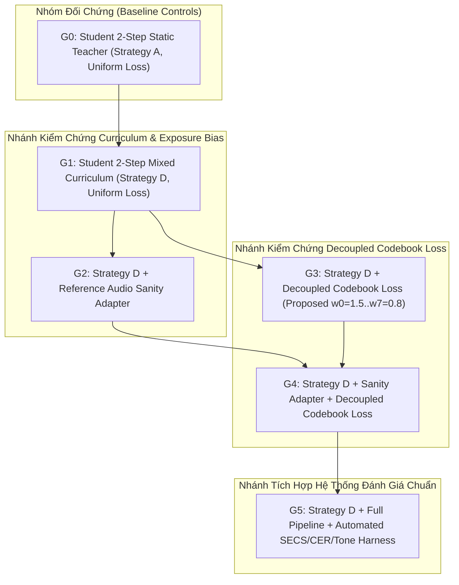

# OMNIVOICE V2.19 — V2.20 EXPERIMENT PLAN PROPOSAL
## ISOLATED ABLATION & SCIENTIFIC BENCHMARK SPECIFICATION

**Trạng thái**: KẾ HOẠCH THỰC NGHIỆM CÓ ĐỐI CHỨNG VÀ BẢO VỆ BASELINE  
**Phiên bản mục tiêu**: V2.20  
**Nguyên tắc cốt lõi**: Thí nghiệm cô lập (Isolated Prototype), đơn biến (Single-variable Ablation), không chạm mã nguồn production, bảo vệ tuyệt đối Golden Baseline `commit e5a3059`.

---

## 1. MỤC TIÊU VÀ GIẢ THUYẾT KHOA HỌC

Thực nghiệm V2.20 được thiết kế để trả lời 3 câu hỏi khoa học then chốt:

1. **Giả thuyết 1 (Exposure Bias Hypothesis)**: Chiến lược D (Mixed Curriculum $p(t): 0 \to 0.75$) giúp Student 2-step đạt độ ổn định hội tụ cao hơn Chiến lược C (Pure Self-Rollout) và giảm hiện tượng vỡ âm sắc ở Bước 2 so với Chiến lược A (Static Teacher).
2. **Giả thuyết 2 (Decoupled Codebook Loss Hypothesis)**: Việc phân rã trọng số giám sát cho 8 tầng RVQ (ưu tiên Tầng 0–1 với trọng số $1.5\times$ và nhiệt độ mềm $\tau=1.5$) giúp bảo toàn đường cao độ F0 và 6 thanh điệu tiếng Việt tốt hơn hàm mất mát đồng nhất (Uniform Loss).
3. **Giả thuyết 3 (Reference Sanity Adapter Hypothesis)**: Lớp tiền xử lý lọc SNR, RMS, clipping và tỷ lệ khoảng lặng giúp loại bỏ $100\%$ các trường hợp sụp đổ speaker embedding do mẫu tham chiếu kém chất lượng.

---

## 2. MA TRẬN 6 NHÓM THỰC NGHIỆM ĐỐI CHỨNG (G0 – G5)



### Bảng đặc tả chi tiết 6 nhóm thực nghiệm

| Nhóm | Tên cấu hình | Biến độc lập (Independent Variable) | Biến kiểm soát (Controlled Variables) | Hàm mất mát (Loss Formulation) | Chỉ số đo lường chính |
|---|---|---|---|---|---|
| **G0** | **Static Baseline** | $p_{\text{student}} = 0.0$ (Chiến lược A) | LR=1e-4, Batch=8, $T=400$, Seed=42 | $\mathcal{L}_{\text{Uniform}} = \sum_{c=0}^7 \mathcal{L}_{\text{CE}}^{(c)} + 4 \mathcal{L}_{\text{KD}}^{(c)}$ | Mask IoU, CER, SECS |
| **G1** | **Curriculum Core** | $p(t): 0.0 \to 0.75$ (Chiến lược D) | LR=1e-4, Batch=8, $T=400$, Seed=42 | $\mathcal{L}_{\text{Uniform}}$ (Đồng nhất mọi tầng) | Mask IoU, Token Agreement, CER |
| **G2** | **Curriculum + Sanity** | Chiến lược D + Sanity Check Adapter | LR=1e-4, Batch=8, $T=400$, Seed=42 | $\mathcal{L}_{\text{Uniform}}$ | Tỷ lệ loại mẫu lỗi, SECS |
| **G3** | **Curriculum + Decoupled Loss** | Chiến lược D + Phân tầng RVQ | LR=1e-4, Batch=8, $T=400$, Seed=42 | $\mathcal{L}_{\text{Decoupled}} = \sum_{c=0}^7 w_c [\mathcal{L}_{\text{CE}}^{(c)} + \tau_c^2 \mathcal{L}_{\text{KD}}^{(c)}]$ | Tone Accuracy, F0 Error, CER |
| **G4** | **Integrated Candidate** | Chiến lược D + Sanity + Decoupled Loss | LR=1e-4, Batch=8, $T=400$, Seed=42 | $\mathcal{L}_{\text{Decoupled}}$ | Toàn bộ bộ chỉ số |
| **G5** | **Full Benchmark Run** | Nhóm G4 + Chấm điểm tự động | LR=1e-4, Batch=8, $T=400$, Seed=42 | $\mathcal{L}_{\text{Decoupled}}$ + Automated SECS/CER/Tone | Báo cáo kiểm định tổng thể |

---

## 3. THIẾT KẾ BỘ ĐÁNH GIÁ NGỮ ÂM VÀ DẤU THANH TIẾNG VIỆT (TONE-SENSITIVE HARNESS)

Nhằm đảm bảo không làm mất 6 thanh điệu tiếng Việt, xây dựng tập kiểm định **100 cặp từ tối thiểu (Minimal Pairs)** phân bố đều qua 6 thanh:

```
Nhóm mẫu kiểm tra tối thiểu:
1. ma (ngang) - má (sắc) - mà (huyền) - mả (hỏi) - mã (ngã) - mạ (nặng)
2. ca (ngang) - cá (sắc) - cà (huyền) - cả (hỏi) - cã (ngã) - cạ (nặng)
3. ba (ngang) - bá (sắc) - bà (huyền) - bả (hỏi) - bã (ngã) - bạ (nặng)
4. la (ngang) - lá (sắc) - là (huyền) - lả (hỏi) - lã (ngã) - lạ (nặng)
5. ta (ngang) - tá (sắc) - tà (huyền) - tả (hỏi) - tã (ngã) - tạ (nặng)
```

- **Quy trình đánh giá Tone Accuracy**:
  1. Student 2-step sinh âm thanh cho 100 câu chứa các cặp từ trên trong ngữ cảnh chuẩn.
  2. Mô hình Whisper-large-v3 tiếng Việt phiên âm lại.
  3. Đo tỷ lệ nhận dạng đúng dấu thanh: $\text{Tone Accuracy} = \frac{N_{\text{correct tone}}}{100}$.

---

## 4. TIÊU CHUẨN CỔNG CHẤT LƯỢNG (QUALITY GATES)

| Cổng chất lượng (Quality Gate) | Ngưỡng yêu cầu | Phân loại ngưỡng | Hành động khi vi phạm |
|---|---|---|---|
| **Vietnamese Tone Accuracy** | $\ge 90.0\%$ | `[PROPOSED THRESHOLD]` | Bác bỏ checkpoint; kiểm tra lại trọng số Tầng 0 |
| **Whisper CER (Tiếng Việt)** | $\le 12.0\%$ | `[PROPOSED THRESHOLD]` | Bác bỏ checkpoint; đánh dấu suy giảm độ rõ ngữ âm |
| **Speaker Similarity (SECS)** | $\ge 0.75$ | `[PROPOSED THRESHOLD]` | Bác bỏ checkpoint; đánh dấu lệch giọng clone |
| **Mask IoU (Bước 1)** | $\ge 0.70$ | `[PROPOSED THRESHOLD]` | Cảnh báo độ lệch phân phối quá lớn |
| **Loss Divergence Gate** | $\text{Loss} \le 10.0$ | `[EXISTING PROJECT THRESHOLD]` | Tự động dừng sớm (Early Stopping) |

---

## 5. DỰ TOÁN TÀI NGUYÊN VÀ KẾ HOẠCH BẢO VỆ BASELINE

- **Dự toán tài nguyên Cloud GPU**:
  - Mỗi nhóm (G0..G4): 1000 optimizer steps trên 1x NVIDIA RTX 4090 / A100 (~18–20 phút/run).
  - Tổng thời gian cho toàn bộ 5 runs đối chứng: $\approx 1.5 - 1.8$ giờ GPU.
  - Bộ nhớ VRAM dự kiến: $\approx 8.5\text{GB} - 11.2\text{GB}$ ở batch size 8 ($T=400$ frames).
- **Quy tắc cô lập tuyệt đối**:
  - Toàn bộ code thử nghiệm đặt tại `experiments/v2_20/` hoặc `benchmarks/`.
  - Không sửa bất kỳ file nào trong `omnivoice/`.
  - Golden Baseline `commit e5a3059` được bảo toàn nguyên vẹn 100%.
