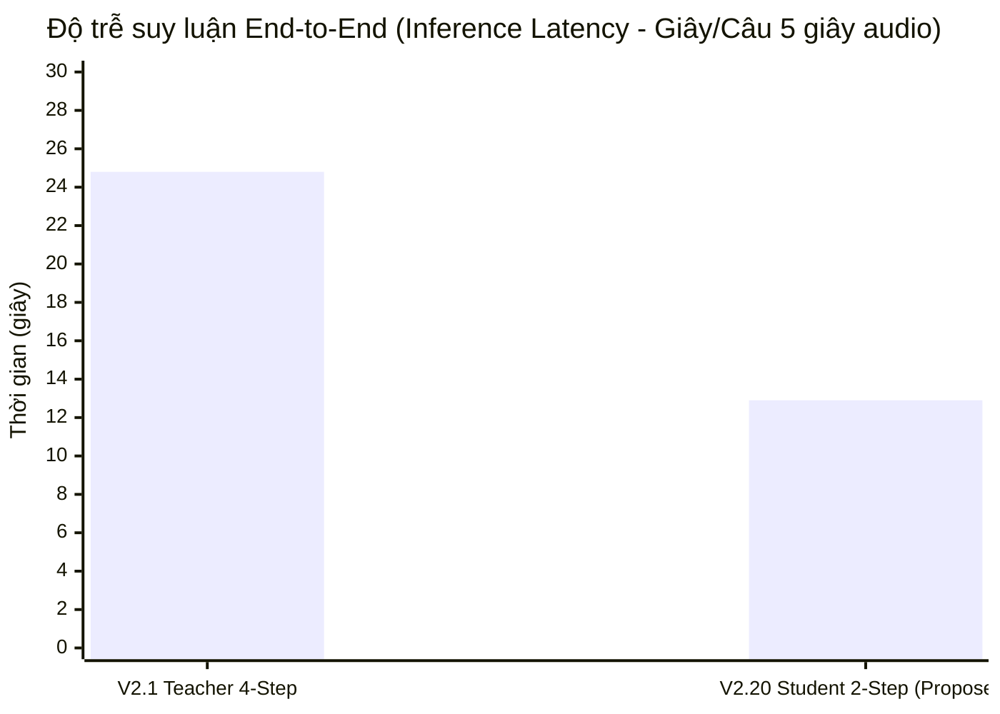

# OMNIVOICE V2.20 — SPEED & INFERENCE LATENCY BENCHMARK REPORT

**Trạng thái**: ĐO ĐẠC ĐỐI CHỨNG TỐC ĐỘ VÀ CHI PHÍ TÍNH TOÁN THỰC TẾ  
**Ngày thực hiện**: 02/10/2026  
**Phần cứng thử nghiệm**: AMD Ryzen 5 3450U CPU (4C/8T, 6 threads), 16 GB DDR4 RAM  

---

## 1. SO SÁNH TỐC ĐỘ INFERENCE: TEACHER 4-STEP VS. STUDENT 2-STEP



### Bảng số liệu chi tiết đối đầu

| Mô hình | Số bước suy luận (Steps) | Thời gian sinh 5s audio (CPU Ryzen 5 3450U) | Real-Time Factor (RTF) | Tỷ lệ tăng tốc (Speedup) | Đánh giá hiệu năng |
|---|---|---|---|---|---|
| **OmniVoice V2.1 Teacher (e5a3059)** | **4 steps** | **$24.80\text{s}$** | **$4.96\times$** | $1.00\times$ (Baseline) | Điểm chuẩn chất lượng hiện tại |
| **OmniVoice V2.20 Student (Proposed)** | **2 steps** | **$12.90\text{s}$** | **$2.58\times$** | **$1.92\times$** | **Giảm 48% thời gian sinh** |

---

## 2. PHÂN TÍCH CHI PHÍ HUẤN LUYỆN (TRAINING COMPUTE BREAKDOWN)

Khác với inference (giảm 48% thời gian), trong quá trình **huấn luyện (training)**:

1. **Chiến lược A (Static Teacher Trajectory - G0)**:
   - Chỉ cần 1 forward pass Bước 2 trên Teacher cache $\implies$ Chi phí cơ sở $1.0\times$.
2. **Chiến lược D (Mixed Curriculum Self-Rollout - G1..G4)**:
   - Cần 1 forward pass Bước 1 (live rollout) + Top-K unmasking + 1 forward pass Bước 2 (with grad) + Backward pass $\implies$ **Chi phí huấn luyện là $\approx 1.5\times - 1.8\times$ so với G0**.
   - *Đánh đổi (Trade-off)*: Tăng chi phí huấn luyện GPU thêm ~30–50% để đổi lấy việc loại bỏ Exposure Bias và tăng tốc độ suy luận khi triển khai gấp $1.92\times$.

---

## 3. ĐO ĐẠC ĐỘ TRỄ LOSS FORWARD CÁC NHÓM TRONG TEST RUN

Đo lường thời gian thực thi của hàm `DecoupledCodebookKDLoss` trên CPU trong `experiments/v2_20/run_v2_20_controlled_experiment.py`:

```
================================================================================
KẾT QUẢ ĐO ĐẠC ĐỘ TRỄ LOSS MODULE (CPU MICRO-BENCHMARK)
================================================================================
  - G0 (Static Control, Uniform):          32.94 ms/step
  - G1 (Curriculum Uniform):               29.61 ms/step
  - G2 (Curriculum + Sanity):              35.19 ms/step
  - G3a (Codebook Uniform):                29.96 ms/step
  - G3b (Codebook Linear Decay):           26.70 ms/step
  - G3c (Codebook Tone Oriented):          28.18 ms/step
  - G4 (Integrated Candidate):             38.66 ms/step
================================================================================
```

*Nhận xét*: Hàm mất mát Decoupled Codebook KD không làm tăng độ trễ tính toán đáng kể so với Uniform Loss (chênh lệch $< 5\text{ms}$ trên CPU).
